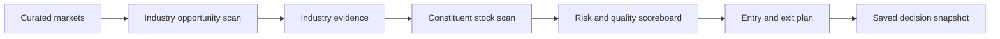

# Redesign Discovery Brief

Status: confirmed product decisions from the owner interview on 2026-10-11.

This brief records what Stockfinder should help its user decide. The domain
glossary defines the vocabulary, and the analysis DSL defines how evidence and
rules should be represented. When this brief conflicts with an older interface,
the redesign should follow this brief unless a later discovery decision changes
it.

## Primary Job

Stockfinder's primary job is to answer:

> Where should capital be allocated, and which stocks in those areas satisfy a
> transparent swing or position-trading setup without exceeding acceptable risk?

The product is an industry-first capital-allocation workspace. It is not
primarily a ticker lookup tool, a news reader, or a single undifferentiated stock
ranking.

## Decision Workflow

1. Review the curated markets and their relevant regime evidence.
2. Find industries receiving increasing capital and showing attractive relative
   strength, trend, fundamentals, or valuation.
3. Compare each industry with its regional index and configured industry proxy.
4. Scan stocks only after an industry has been prioritized.
5. Allow a stock to qualify through any enabled setup rule, then rank qualifying
   stocks by continuous evidence strength.
6. Inspect quality, growth, forecasts, fundamentals, and a comprehensive risk
   scoreboard for a selected stock.
7. Build an entry and exit plan, save the evidence that produced the decision,
   and record either a thesis or a rejection reason.

The application should preserve the selected region and industry while the user
drills into a stock and returns to comparisons.

## Supported Horizons

The redesign initially serves two independent workflows:

- **Swing**: days to several weeks.
- **Position**: several weeks to months.

Each workflow has its own validated preset, thresholds, ranking weights, and
historical evaluation. Every preset value remains manually editable. Intraday
and long-term investing are not primary redesign workflows.

## Curated Market Scope

The first redesigned market universe includes:

- United States.
- Broad Europe, including euro and non-euro developed European markets.
- Japan.
- China and Hong Kong.
- South Korea.
- Taiwan.
- A broad Asia benchmark/proxy for regional context.
- Stocks, ETFs, and funds relevant to those markets.

Market selection is curated rather than an automatic all-country global ranking.
Every local market must have an explicit regional benchmark, currency, exchange
calendar, and industry/sector proxy fallback. Cross-region normalization is not
the primary ranking model.

## Industry Opportunity Model

Industry selection comes before stock selection. An industry can qualify through
one or more independently activatable criteria:

- Increasing capital/liquidity evidence.
- Relative strength versus its regional index and configured industry proxy.
- Positive trend and momentum over explicit horizons.
- Improving aggregate fundamentals.
- Attractive valuation versus its own history and relevant peers.
- Configurable alignment with macroeconomic themes expected to matter over
  coming months or years.
- Configurable news and social evidence.

The result must show pass/fail status, all failed conditions, actual values and
thresholds, data completeness, peer/index differences, rank among peers, and
change since the prior scan.

### Capital And Smart-Money Evidence

“Smart money” is a product concept, not an observable actor identity. The UI and
DSL must expose the underlying evidence category instead of presenting one
unsupported smart-money number:

1. **Direct vehicle flow**: reported ETF/fund subscriptions and redemptions.
2. **Delayed positioning**: institutional filings and holdings changes.
3. **Reported transactions**: insider transactions.
4. **Derivatives positioning**: unusual options volume, open interest, and skew.
5. **Licensed market activity**: dark-pool or block data when available.
6. **Inferred accumulation**: stock and ETF price-volume behavior, breadth, and
   sustained relative strength.
7. **Attention context**: news, social media, and X/cashtag activity after entity
   resolution and spam/bot controls.

Stock and ETF volume are required initial evidence. Direct flows, filings,
insider activity, options, block data, news, and social signals are separately
sourced enhancements. Missing premium evidence remains unknown and must not
penalize or benefit a candidate silently.

Capital-movement monitoring is adjustable for both industries and stocks. It
defaults to **Daily**, comparing the latest completed trading session with the
previous comparable session. Quick choices are Daily (`1s`), Weekly (`5s`), and
Monthly (`21s`), with an editable custom trading-session window. The selected
period persists per Swing or Position profile and must be visible beside every
movement value and ranking.

Session windows are preferred over calendar-day windows so holidays and
different regional exchange calendars remain comparable. The current
end-of-day pipeline supports completed-session monitoring, not live intraday
capital movement.

## Stock Qualification And Ranking

Every setup filter is independently activatable. A stock qualifies when **any**
enabled setup rule passes. Passing one rule establishes eligibility; it does not
make all candidates equally attractive.

Initial setup families include:

- Constructive price consolidation.
- Price crossing or reclaiming the 50-day moving average.
- Rising 50-day moving average.
- Price above or confirming the 150-day moving average.
- Increased volume over configurable short and medium periods.
- Relative strength versus industry peers and the industry proxy.

Ranking is continuous after qualification:

- A longer constructive consolidation receives more credit because it can
  represent a more developed base.
- A more recent meaningful increase in volume receives more credit because it
  can indicate an emerging move.
- The score must cap both effects to avoid unlimited reward for stale bases or
  one-day volume anomalies.
- Price-volume evidence must distinguish constructive accumulation from volume
  caused by a price decline or isolated event.

The output shows which rule or rules qualified the stock, actual metric values,
thresholds, failed rules, missing evidence, peer rank, and change since the prior
scan.

## Macro, News, And Social Role

Macroeconomic evidence can indicate industries likely to gain or lose relevance
over months or years. It serves two configurable roles:

- A separate, visible industry attribute.
- A ranking boost or penalty under a named strategy.

Macro alignment is not a universal hard exclusion.

Financial news, social media, and X/cashtag evidence are configurable ranking
signals for both industries and stocks. They must begin as separately visible
evidence and can affect ranking only when a strategy explicitly enables a named,
validated signal. Source, timestamp, model version, entity-resolution confidence,
and bot/spam filtering remain visible.

## Stock Scoreboard

The selected-stock view must keep suitability, timing, and risk separate.

### Quality, Growth, And Fundamentals

- Revenue and earnings growth, consistency, and estimates.
- Revenue and EPS estimate revisions.
- Operating cash flow and free cash flow, including forecasts.
- Profitability, margins, ROE, and ROIC.
- Debt, liquidity, interest coverage, and refinancing profile.
- Company guidance and guidance changes.
- Analyst targets and recommendation changes, clearly labeled as opinions.
- Valuation versus industry peers and the stock's own history.

### Risk

Every selected risk category should be immediately visible:

- Realized volatility, ATR, and drawdown.
- Balance-sheet and refinancing risk.
- Earnings, guidance, and other event risk.
- Trading liquidity and position capacity.
- Valuation risk.
- Portfolio concentration and correlation.
- Country, jurisdiction, and currency risk.

Missing evidence reduces completeness. It is not treated as low risk.

### Comparisons

The stock should be compared with:

- Direct industry peers.
- Its configured industry index or ETF.
- Its regional market index.
- Its own historical ranges.

Every comparison must show the difference, not just place values in neighboring
panels.

## Entry And Exit Planning

For a qualifying stock, the user can save:

- Watchlist membership and notes.
- Investment or trade thesis.
- Planned entry zone.
- Target and position size.
- The exact rule and evidence snapshot that caused qualification.
- A rejection reason when the candidate is deliberately declined.
- An exit plan.

The exit plan presents candidate invalidation levels derived separately from:

- Volatility and ATR.
- Current price and planned entry.
- Recent swing lows and other price structure.
- Relevant moving averages.

The application may compare these candidates and calculate risk-constrained
position size, but must not imply guaranteed stop execution or place an order.

## Scan Experience

The first screen after a scan should use the active capital-movement period and
show both:

1. What changed: newly strengthening industries, newly qualifying stocks, and
   material improvement or deterioration.
2. What leads now: current industry and stock rankings.

Change is emphasized first. Negative/avoidance scanning is a recorded future
feature, not an initial redesign requirement.

## Rule Configuration And Validation

The application ships with validated Swing and Position presets. A threshold is
a numeric rule boundary such as minimum consolidation length, volume relative to
its moving average, or required distance from a moving average.

Validation means replaying a fixed rule on historical data using only evidence
available at each historical date. Reports should include forward returns,
drawdown, hit rate, turnover, sample size, and behavior across market regimes.
Validation supports preset selection; it does not guarantee future performance
or silently optimize user settings.

The user can edit every threshold and enable or disable every filter. The UI must
show when settings differ from the validated preset.

## Data Strategy

- Use free sources first.
- Design provider contracts so optional paid sources can improve specific
  signals without changing their meaning.
- Identify the source and cost class for each signal.
- Never fabricate unavailable macro, flow, positioning, news, or social data.
- Keep direct measurements, delayed disclosures, and model inferences visibly
  separate.

## Redesign Acceptance Criteria

The redesign is successful when the user can:

1. Identify which curated industries are newly attracting capital over an
   adjustable period, defaulting to Daily, and understand the supporting
   evidence.
2. See why each industry passes, fails, or cannot be evaluated.
3. Drill into that industry before scanning and ranking its stocks.
4. Activate any combination of setup filters and see which rule qualified each
   stock.
5. Compare every candidate with peers, its industry proxy, regional index, and
   own history.
6. Inspect complete quality, growth, forecast, and risk evidence without mixing
   those dimensions into an opaque score.
7. Save the entry plan, exit plan, rule snapshot, notes, or rejection reason.
8. Reproduce a result later from its rule version, settings, data timestamps, and
   evidence trace.

## Deferred Or Unresolved

- Exact benchmark and proxy symbols for each curated local market.
- Exact formulas and caps for consolidation-length and volume-recency scoring.
- Minimum provider quality needed before news or social signals can affect rank.
- Optional paid-source budget and priority after free-source coverage is known.
- Symmetric weakening/avoidance scans.